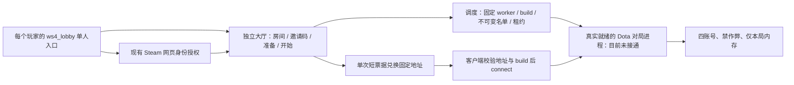

# 独立大厅与对局调度：2026-10-25

## 结论与当前状态

可以借鉴《保卫小塔》DoDoTD Defence (Test Version)，ID `2637453327` 的分层设计：每个玩家进入单人大厅，由后端组队并给同一房间分配同一个对局进程。Survival 已加入独立实现的大厅地图、界面、房间服务、租约和连接适配代码。

**这不是已上线的多人服务器。** 当前大厅默认关闭，未更新原工坊包、未启用云端大厅、未注册可用 worker。已有单人云存档入口保持原发布状态。实际对局服务器挂载自定义地图、Steam 服务器身份以及两机同局尚未通过；不得把后端单测、UDP 监听或建房成功写成联机成功。

用户本轮授权：四个现有测试账号、禁作弊、对局仅本局内存、不读写云存档、不接商城和支付；另一台电脑暂不方便，先验证主机。大厅的 Steam 身份登录与战斗存档服务分离。

## 自有实现

| 模块 | 路径 | 行为与边界 |
|---|---|---|
| 独立大厅地图 | content `maps/ws4_lobby.vmap`；game `maps/ws4_lobby.vpk` | 自有原生编译的轻量地图，1 个玩家。正式地图仍为 `template_map`，容量 4。 |
| 大厅界面 | content/game `panorama/.../custom_game/survival_lobby.*` | 仅 `ws4_lobby` 显示；邀请码加入、准备、房主开始、状态与重新连接。未认证、未知状态、失联或无服务器时不允许假开局。 |
| 大厅服务端控制器 | `scripts/vscripts/systems/hosted_lobby.lua` | 独立于战斗和档案初始化；真实事件源绑定玩家，保留认证令牌在服务端，异步请求有超时和世代检查。 |
| 大厅后端 | `server/lobby_backend/` | 进程内房间、4 人上限、邀请码、版本比较、幂等请求、worker 租约、短票据及重连。重启丢失大厅状态，客户端遇到失效房间回到大厅。 |
| 身份适配 | `AuthServicePrincipalAdapter` 与可选 web-auth 路由 | 复用经过验证的 pwa1 身份，校验原账号/来源会话，不接收客户端自报 SteamID 为身份。 |
| 连接桥 | `scripts/custom.gameevents`、`systems/hosted_lobby_client.lua` | UI 仅转发 address/match_id/build_sha256；客户端再次校验固定地址与 build。不会执行后端返回的任意命令文本。 |
| 本局测试档 | `systems/session_multiplayer_test.lua` | 明确配置启用，要求原生服务端、真实四账号门禁、正确地图、web-auth 战斗入口关闭且 `sv_cheats=0`。按账号、模式和本局隔离，不调用 HTTP 或读写文件。 |

大厅的 `lobby_` 授权会话只用于身份和房间。云代理以**已持久化的认证会话**判定，拒绝此类会话的档案读取、进度写入和商城路由；网页也明确说明本次授权范围。认证 401 会废弃本地绑定、重新申请短码，业务权限错误不重置身份。记住浏览器的机制仍只免除重新登录 Steam，每次新的授权范围仍需确认。

目前两个配置均默认关闭：`config/hosted_lobby.lua`、`config/session_multiplayer_test.lua`。现有离线逻辑入口与联网云存档入口的既有配置未切换。未把缺失 HTTP 或认证失败变成离线回退。

## 调度和真实服务器的约束

后端将地址限制在可信配置中的 `WorkerSpec`；玩家不能注册 IP、指定任意目标或自行标记服务器就绪。worker 的身份校验器与就绪校验器缺失时拒绝注册容量。仅真实验证过的空闲进程才可分配。

分配绑定 room、fresh match、worker generation、lease、build 和冻结账号名单。票据 60 秒、单次使用、账号绑定；断线后为同一仍有效的对局重新出票。worker 失联或租约过期会使房间中断，不将玩家静默转到另一局。本房间的 worker 仍在线时允许重连；其他空闲 worker 不能使失效旧房间假恢复。

**实际 worker 还必须用引擎解析的 Steam 身份校验本房间冻结名单。** 全局四账号白名单和内存 provider 不能替代此步骤。当前没有实现并启用一个通过原生验收的 worker，后端默认 `worker_available=false`、开始返回 `no_ready_worker`；票据兑换一直标明 `native_connection_verified=false`。

杭州现有服务承载网页登录、数据库和业务接口，不是已验证的 Dota 对局服务器。不能仅增加 Python 进程、放行一个端口，或租一台云主机就宣称完成对局托管。

## 参考包证据与独立实现范围

[工坊页面](https://steamcommunity.com/sharedfiles/filedetails/?id=2637453327) 确认名称和《保卫小塔》介绍，但没有提供后端、服务器部署或调度接口。

本机只读核对的包为 `2637453327.vpk`，798,975,852 字节，SHA256 `05bf1a0a807ec7f219c105e36deddd28c38976703fb26eeda2298224fb741e57`。

- `addoninfo.txt` 默认 `launch`，入口容量 1，`test` 容量 24。
- 可读 `scripts/vscripts/launch_connect.lua`（单行，SHA256 `f657bdb2cd12e8b8b1abaaf475b5859f3df07a0b0bff5bb04e351698f29ee821`）可确认创建/加入/开始房间、轮询后端、得到已开始房间后转交连接事件的流程。
- `scripts/custom.gameevents` 声明了其 UI 到客户端 VM 的字符串事件。我们采用自有三字段、地址和 build 双重校验的事件，不接收任意命令文本。
- 正式客户端命令执行端、服务器和 HTTP 核心是受保护模块，未解密；不能从本地包证明其具体连接语法、服务器归属或当前可用性。
- 没有调用第三方接口、使用包内凭据、复制其受保护业务代码。Survival 的大厅服务及连接器是独立实现。

## 本机独立服务器实测

固定使用临时端口 27025，未改 Valve 二进制、未伪造专用服凭据、未添加 `-insecure` 或关闭 VAC。

| 检查 | 实际结果 |
|---|---|
| 当前 `dota2.exe -dedicated` + 核心 `dota` 地图 | 能启动 Windows dedicated，UDP 27025 监听，`sv_cheats=false`。 |
| 专用服的 `dota_launch_custom_game` | 当前专用进程未注册此客户端命令。 |
| `map template_map customgamemode=survival` | 当前资源未挂载，报 `invalid map name`。`-addon survival` 也未完成挂载。 |
| Steam 服务器身份 | 观察时仍为 disconnected from Steam3；API 激活日志不等于认证成功。 |
| 正式自定义地图 HTTP | 未能加载自有地图，故未测试。 |
| 真实 worker 可用 / 两账号两机同局 | 未通过 / 未运行。 |

探针已经退出。主要证据：`output/hosted_lobby_20261025/dedicated_final_result.json`，其 SHA256 为 `bf48106dbe2bdc577dba69058d279bde2c56abf5051f9c66f6cbc86dd6b946a5`。日志和控制台快照留在同目录，不将凭据或运行输出提交 Git。

另做过一次主机 Tools 大厅预览：实际截图显示 Valve `Stall Detected: 127.7s`，尚未观察到大厅地图加载。布局、授权短码和客户端私有事件的原生显示均未通过验收。临时启用的大厅配置已逐字节还原，正常关闭无响应后仅清理本次新建的测试进程；最终无 Dota 遗留进程。证据为 `output/hosted_lobby_ui_20261025T080302_462880Z/result.json` 与该目录的 `preview.png`。界面原生编译及模拟事件回归通过不能替代这次未完成的视觉验收。

官方 [Dota Reborn 更新](https://www.dota2.com/reborn/updates) 描述的是 Valve 托管自定义游戏；通用 [Steam 游戏服务器发行](https://partner.steamgames.com/doc/sdk/uploading/distributing_gs) 和 [SDR](https://partner.steamgames.com/doc/features/multiplayer/steamdatagramrelay) 文档针对具有对应游戏权限的开发者。未找到普通 addon 作者将第三方对局服接入 app 570 GC 的公开部署流程。这是本轮证据的边界，不据此断言第三方托管技术上绝无可能。

## 后续接通顺序

1. 取得一个能够实际挂载 Survival、完成所需 Steam 连接、允许客户端进入的游戏服启动方式或平台接口；先保留其真实日志验收。
2. 加入 worker 启停适配、固定 build 和端口、独立服务凭据、进程监督、租约续约和本房间引擎名单校验。不能用测试夹具的 ready 函数部署。
3. 在单主机上通过大厅登录、分配、进入实际 `template_map`，核对禁作弊、模式选择、建造与波次、本局数据清空和零云存档调用。
4. 另一台可用时，用两个不同获准账号实测同局、邀请码、断线重连、房主退出、超时回收与跨网延迟。
5. 原生链路通过后再生成和签名完整候选、上传原不公开工坊条目、用官方重新下载校验。当前没有用尚不可用的大厅替换原可玩包。

自动回归覆盖与最终提交见配套 `docs/validation/HOSTED_LOBBY_20261025.json`。单元测试中的身份和 worker 是隔离夹具，不当作真实原生联机证据。

本次提交候选的独立 Lua 快照通过 8 组回归，Python 通过 140 项、另有 2 项跳过，Panorama 模拟交互通过 225 项，4 项界面资源原生编译通过。共享工作区同时有未提交的新手引导改动；其新增的账号策略依赖使旧入口的隔离夹具失败。原始失败日志保留，提交候选排除这些并行改动后旧入口 87 项检查通过；这不表示整个共享工作区所有任务的测试均通过。
